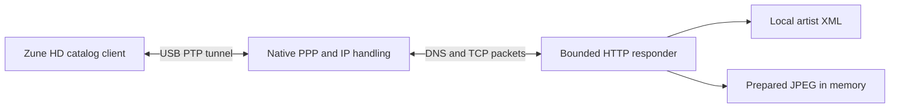

# How Zune HD artwork travels over USB

The Zune HD can request artist pictures over its USB connection. Our native C
experiment answers those requests inside the same process that owns the Zune.
It does not need a hosted website, a listening network socket, Wi-Fi, or changes
to the computer's network settings.

This is currently experimental `zunetool` code, not a finished public libzune
artwork API or an automatic Zuuned feature. For dated hardware evidence and
remaining gates, see [HD artwork research](HD_ARTWORK_RESEARCH.md).

The latest full-album follow-up restored a verified 16-track Disturbed album.
After the user's deletion and restart, the HD acknowledged all six gallery
JPEGs, a separate background, a thumbnail and the nonempty biography in one
session. The user confirmed the biography works on the device. Persistence after
another restart and safe existing-artist replacement remain separate gates.
The expected display roles are one Now
Playing background and a separately browsable artist gallery. Playback rotation
is not a demonstrated firmware requirement.

## A small server inside the USB session

The device still speaks familiar network protocols. We carry their packets
through Microsoft's USB tunnel and answer them locally. Addresses such as
`catalog.zune.net` identify requests inside that exchange; the responder does
not contact those websites or forward arbitrary requests to the Internet.

There are several layers, each with a separate responsibility:

| Layer | What it does |
| --- | --- |
| libusb, PTP and MTPZ | Open and authenticate the actual Zune connection. |
| Vendor tunnel controls | Open the device's stream, send bytes and poll for received bytes. |
| PPP | Frame bytes, verify checksums and negotiate link options and IP addresses. |
| IP, DNS and TCP | Answer the device's name lookups and exchange reliable response segments. |
| HTTP and catalog XML | Recognize the selected artist's requests and return local metadata or JPEG bytes. |

The experimental PPP addresses are `192.168.55.100` for the responder and
`192.168.55.101` for the device. They are packet fields inside the USB tunnel,
not addresses assigned to a Linux interface. No TUN/TAP device, routing rule,
system DNS override or firewall change is created.

## What happens during the successful experiment

1. A single owner opens and authenticates the HD. The optional initialization
   sequence and tunnel setup run on that same serialized connection.
2. The HD sends `CLIENT`; we reply `CLIENTSERVER`. Hardware sometimes repeats
   the greeting before PPP starts. The parser accepts up to four greetings,
   including fragmented or coalesced reads. Once PPP begins, greeting handling
   ends and normal frame validation applies.
3. PPP negotiates LCP link options and IPCP addresses. Unsupported compression
   is rejected. The native responder can then receive the HD's IP packets.
4. The first-sync experiment creates an isolated artist, album, media folders
   and tagged track while the network session is ready. The artist has the
   test catalog GUID in `DA97`; album and track use `DAB9` to refer to that exact
   artist. The album references the track.
5. The HD requests catalog metadata and images. The responder supplies bounded
   artist overview, biography and image-list XML, plus the prepared JPEG for
   supported image routes. Unimplemented catalog requests are rejected.
6. TCP acknowledgments establish that the response bytes arrived. The tunnel
   is then closed. An explicitly retained test also verifies the complete
   object graph and audio payload, writes a durable record and requests a
   reindex handoff. Retention is separate from successful image delivery.

The October 18 fresh-artist test recorded three DNS queries, nine HTTP requests,
two acknowledged JPEG responses and one acknowledged background response.
The later Billie visual-test run also acknowledged the background. These are
transport results. Screen appearance, persistence after reboot, and replacement
of cached artwork require their own observations.

## Pictures have different roles

The firmware and actual requests distinguish these resources:

| Resource | Meaning supported by current evidence |
| --- | --- |
| Artist overview and `/primaryImage` | Artist identity and a primary picture route. |
| `/images?chunkSize=10` | An artist image collection. Firmware has a separate `images.xml` cache name. |
| `/image/{image-id}` | A particular image identified by its own ID. |
| `/deviceBackgroundImage?width=480&resize=true&contenttype=image/jpeg` | A dedicated background route, paired with firmware cache name `nowPlayingBg.jpg`. |

The original single-image test shared one JPEG buffer across its image routes.
Two acknowledged JPEG responses therefore did not demonstrate two different
pictures or a working slideshow. The experimental multi-image responder now
accepts a bounded immutable asset table with separate image IDs, actual
dimensions, and explicit background and primary choices. It counts completed
transfers, distinct image IDs and distinct image contents separately.
`chunkSize=10` is a request parameter, not a proven image-count limit. The
inspected Pavo collection loader attempts the first six feed entries. That is
not a measurement of total cache capacity or proof of visible rotation.

The explicit role experiment uses `--thumbnail UUID JPEG` alongside up to six
`--gallery UUID JPEG` pairs. The positional JPEG remains the device background;
only the gallery pairs enter the image feed. The thumbnail supplies the overview
image and primary route. These roles have separate IDs and permit up to eight
assets, each limited to 128 KiB. Legacy `--gallery`/`--primary` behavior remains
available without `--thumbnail`; the two primary-selection options cannot be
combined. All images are decoded before connecting and remain immutable during
the session. Collection acknowledgments are reported separately from all assets.

The explicit thumbnail role permits its prepared width and the observed
`width=480&resize=true` request for a 160-wide thumbnail, returning the original
160-wide JPEG as the static reference templates do. This is a narrow role-specific
compatibility rule, not an image resizer. Other image roles retain exact prepared
width validation. Catalog dimensions remain the actual JPEG dimensions in this
experiment; the reference template's hardcoded 1000x1000 is not adopted as a
general requirement.

The background request specifies width 480 but no height. Preserve source aspect
ratio when preparing a width-based image unless the user explicitly chooses a
crop. A fixed square or screen-shaped crop is a product choice, not a requirement
established by that URL. The responder serves prepared bytes; it does not fetch,
select or convert provider pictures itself.

## Why fresh artists matter

The proven request sequence followed creation of a new, coherently linked test
artist and track. Earlier experiments changing an existing artist's `DA97` did
not trigger image requests during their observation windows. We do not yet know
the reliable cache-refresh contract for existing artists, or which individual
part of the successful fresh graph triggered fetching.

Do not turn that uncertainty into a delete-and-recreate workflow for a user's
library. Existing artist identities, tracks and album references must remain
protected. The retained Billie experiment uses its own `HDArtworkProbe-...`
identity; it does not replace the existing Billie artist. Preserve retained
tests until the user finishes inspecting them and requests cleanup.

## Code map

These are private tool entry points, rather than exported `zune.h` functions:

| Source | Main entry points and responsibility |
| --- | --- |
| [zunetool.c](../tools/zunetool.c) | `cmd_hd_art_serve`, `cmd_hd_art_recover_graph`: validate options and own the connection and diagnostics. |
| [hd_http_init.h](../tools/hd_http_init.h) | `hd_http_init_run`, `hd_http_init_full_ex`: isolated experimental initialization operations. Successful responses do not alone prove artwork fetching. |
| [hd_network_probe.h](../tools/hd_network_probe.h) | `hd_network_probe_run_ex_lifecycle`, `hd_network_startup_feed`: tunnel lifecycle, bounded greetings, PPP negotiation and serialized callbacks. |
| [hd_image_server.h](../tools/hd_image_server.h) | `hd_image_server_init`, `hd_image_server_set_assets`, `hd_image_server_set_artist`, `hd_image_server_packet`, `hd_image_server_tick`: local DNS/TCP/HTTP responses and bounded retransmission. |
| [hd_art_gallery.h](../tools/hd_art_gallery.h) | Validate and fully decode bounded local JPEGs before connecting; keep immutable buffers alive for the session. |
| [hd_art_serve.h](../tools/hd_art_serve.h) | `hd_art_serve_experiment`, `hd_art_packet`, `hd_art_tick`: connect the responder to PPP and optional first-sync work; report image and background acknowledgments separately. |
| [hd_art_first_sync.h](../tools/hd_art_first_sync.h) | `hd_first_prepare`, `hd_first_tick`, `hd_first_complete`: durable intent, isolated object creation, exact verification and optional retention. |
| [hd_art_album_sync.h](../tools/hd_art_album_sync.h) | `hd_album_local`, `hd_album_prepare`, `hd_album_tick`, `hd_album_complete`: a separate retained full-album experiment with an ordered local plan, fresh artist identity, complete audio readback and independent journal. It never deletes objects. |
| [hd_art_album_recovery.h](../tools/hd_art_album_recovery.h) | `hd_album_recovery_load`, `hd_album_recovery_inspect`, `hd_album_recovery_prepare`: inspect a strict interrupted creation prefix and explicitly prepare a separately journaled continuation. Lost or malformed creation responses never authorize a retry. |
| [hd_art_graph_recovery.h](../tools/hd_art_graph_recovery.h) | `hd_first_graph_recovery_inspect`, `hd_first_graph_recovery_delete`, `hd_first_graph_recovery_retain`: exact recorded-graph recovery with live identity and payload checks. |

The packet responder has sixteen TCP flow slots, bounded requests and retransmits,
and no general proxying, TLS, IP-fragment reassembly or TCP out-of-order buffer.
Its diagnostic `fwlink` HTML response does not implement Microsoft's signed
secure-clock protocol. Neither that response nor a JPEG acknowledgment should
be described as a successful secure-clock exchange.

USB calls remain serialized even while HTTP responses and metadata creation
interleave. Unknown writes or uncertain transport stop further operations and
preserve the recovery record. A deadline bounds scheduling; it does not cancel
an already running USB transaction instantaneously.

### Supplying an artist biography

The private research command accepts `--biography /path/to/artist.txt` alongside
the existing artist GUID, background and optional gallery arguments. Supply
plain UTF-8 text, not HTML or XML. Input is limited to 4096 bytes and checked
before connecting. The responder generates escaped HTML inside the original
Atom `content type="html"` contract; source markup stays literal text.

Biography text is pinned in memory for that session. The configured artist's
`/biography` route serves it over the same USB tunnel, without fetching a remote
provider or changing music tags. A separate `biography-result` reports requests
and complete acknowledged responses. With this explicit option, successful
completion requires a biography acknowledgment. An existing-artist refresh does
not require the HD to download its background again; fresh-artist/full-album
creation retains its separate background proof and waits for configured gallery
responses before quiet early completion. Existing image-only behavior is retained.

This supplies a response when the HD requests it. It is not a cache invalidation
command: a previously cached empty biography may not be fetched again. Do not
infer visible text from an ACK or delete/recreate an artist automatically to
force a refresh. No biography editor or automatic biography provider is wired
into the production app yet.

On October 19, after the user deleted the test album on the HD and restarted it,
a fresh import using the same catalog GUID received two biography requests and
two full response ACKs, plus all eight configured image assets. Separate full
album verification and reindex handoff passed. Earlier attempts without that
user deletion/restart sequence fetched no biography. The user subsequently
confirmed the biography worked on the device. This establishes delivery and
visible text for this test, not a general cache invalidation contract.

Software fixtures are available through `tests/run-hd-network-probe.sh`,
`tests/run-hd-image-server.sh`, `tests/run-hd-art-first-sync.sh` and
`tests/run-hd-art-album-sync.sh`. They use
mocked transport or in-memory packets, not USB. Passing them is distinct from
hardware delivery, visual rendering and cache-update validation.

The full-album path preserves supplied artist, album, track titles, disc/track
order and durations. It requires an absent artist and unused catalog GUID;
existing artists cannot be replaced through it. Its current limits are 64 MP3
tracks, 32 MiB per track and 256 MiB total. Prepared MP3 inputs need independent
codec verification: the helper checks file stability and MP3 signatures, then
compares all transferred bytes, rather than decoding arbitrary audio formats.
An optional album cover uses the album's representative-sample property,
separately from the artist background and gallery served over HTTP. Failed or
interrupted runs retain the journal and any created objects for inspection.
The separate album journal is not compatible with the one-track recovery tools.

Pavo can report a newly transferred track's album as `Unknown Album` until the
abstract album references it. The experiment accepts that provisional state,
then requires the requested album name after linking. Observed default disc 1
may read back as zero on Pavo; other disc values remain exact. These readback
rules do not rewrite source tags or merge album editions.

An interrupted session can also cause firmware to prune its empty abstract
album and make temporary Unknown Album/Unknown Artist objects. The bounded
continuation path recognizes only the recorded first-track case, proves the
entire original inventory and exact surviving identities and bytes, and checks
that the two new placeholders refer only to that track. It may replace the
proven missing owned album, preserving the existing artist, track and folders.
Neither placeholder is deleted. Their identities remain recorded, with final
inventory checks allowing their continued presence or firmware removal.

The original album journal recorded source paths, sizes and metadata, but no
source-content hashes. It cannot prove unchanged bytes for tracks that were
never uploaded. Continuation treats those as freshly reviewed local inputs,
holds them unchanged in memory, and records SHA-256 hashes of all current audio,
the cover and the original journal before any resumed write. Already uploaded
audio must match the complete device readback. Continuation journals have a
distinct layout and are deliberately refused by the original-prefix loader.

Protocol leads include the inspected XuneSyncLibrary and ZuneNetApi references,
alongside our captures and offline firmware analysis. Their pinned revisions
and attribution are recorded in [HD artwork research](HD_ARTWORK_RESEARCH.md).
The native implementation is independent; no third-party server must run with it.

## Reusable C integration (October 19)

The responder implementation now lives in shared private modules under
`src/hd/`, used by both research tools and `src/hd_artwork.c`. See
[the public API integration guide](HD_ARTWORK_API.md) for validated configuration,
serialized READY callbacks, strict artist identity handling, per-role ACKs,
partial/cache results, examples and the hardening handoff. This extraction does
not turn previous research hardware acceptance into acceptance of Zuuned's new
ordinary music-sync ordering; that remains a separate physical test.
